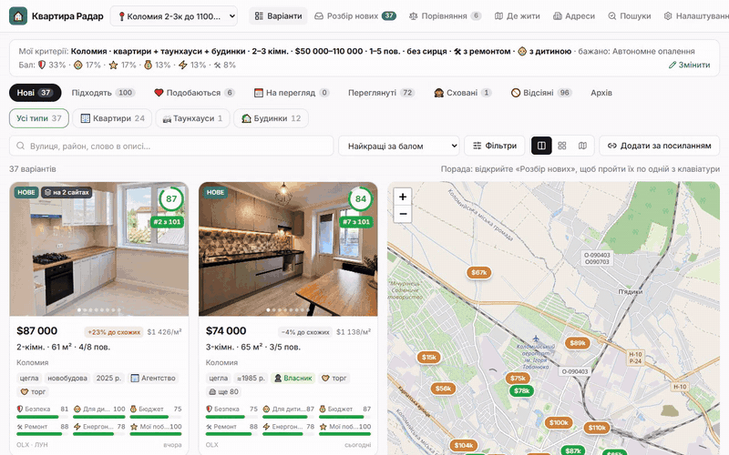
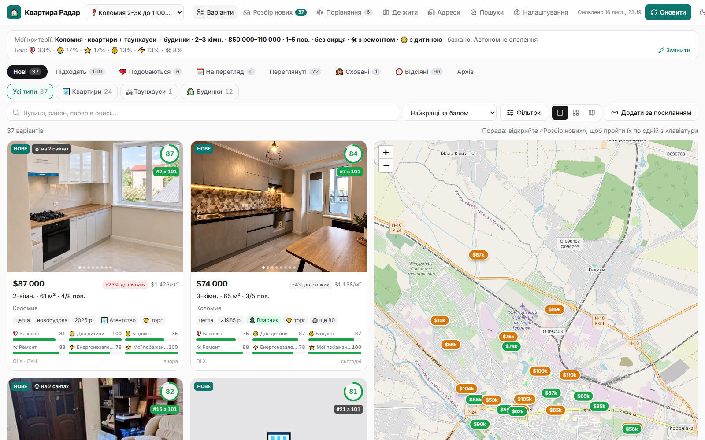
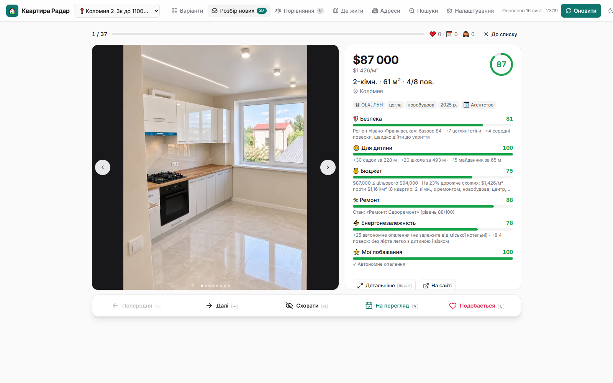
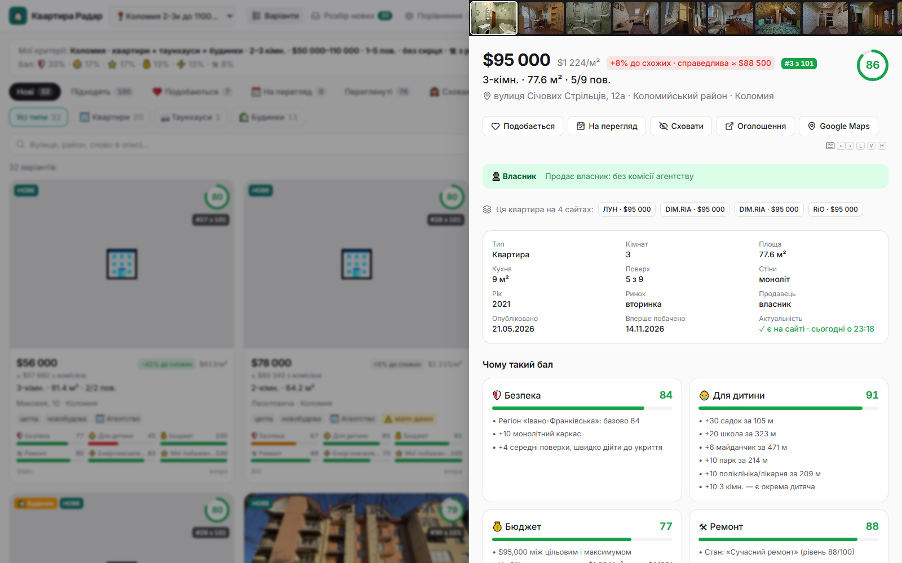
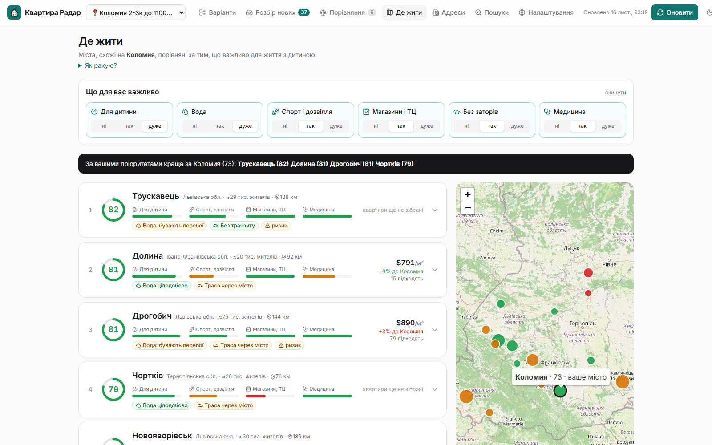
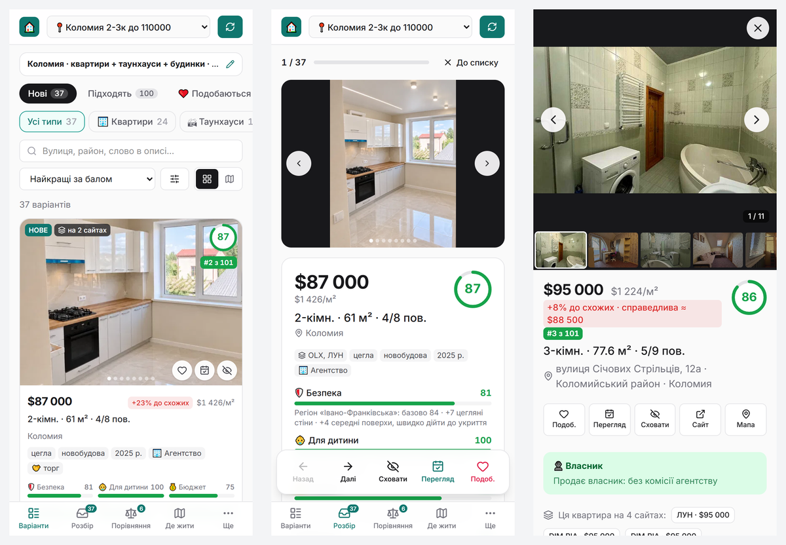

# Kvartyra Radar: an apartment hunt that rules flats out

A personal decision assistant for buying an apartment in Ukraine. It gathers for-sale listings from nine
Ukrainian sites into one feed and merges the same flat posted on several of them into one card. It scores
every flat 0–100 against the family's own criteria and says why. A local AI model checks whether the
photos match the text. Telegram gets a message when something worth seeing appears.

> Listing sites are built to show you as many ads as possible. This one is built to help you **rule most
> of them out** and decide between the few that are left.

**Try it:** [the live app](http://173.242.58.130/), in guest mode. Browse the real listings, like and hide
flats in your own sandbox, and send feedback with the **Відгук** button. The interface is in Ukrainian.



> The source code is private. It is available on request for a review: get in touch on
> [LinkedIn](https://www.linkedin.com/in/oleh-pavlushenko-415a5115b/).



## The problem

Buying a flat in a smaller Ukrainian town means fighting several things at once:

- **The same flat is scattered.** It is on OLX, DIM.RIA, LUN, Rieltor and local agency sites, often at
  different prices and posted by different agents.
- **The listings mislead both ways.** "Designer renovation" is written over bare concrete, while a fully
  finished flat is described only as "new building, 3rd floor".
- **"Is this price fair?" has no easy answer.** A city-wide average mixes the centre with the outskirts,
  and bare shells with renovated flats.
- **No site filters by what a family checks today.** That means safety (the region, the walls, a shelter
  nearby), autonomous heating, a kindergarten within walking distance, and a flat you can move into right
  away.

## What it does

| | |
|---|---|
| **One feed from nine sites** | DIM.RIA, OLX, LUN, Rieltor, est.ua and four regional sites, plus adding any listing by its link. No API keys or accounts: it reads the same public pages the sites show. |
| **One card per flat** | Reposts across sites and agents merge into one card: "on 4 sites: LUN $95 000 · DIM.RIA $95 000 · RiO $95 000". |
| **A score you can read** | Safety, kids, budget, renovation and energy independence, weighted by your priorities. Every point has a reason ("+30 kindergarten 105 m away"). A flat that fails a hard requirement goes to an *Excluded* tab with the reason; nothing disappears silently. |
| **A fair price** | The median $/m² of *comparable* flats: same rooms, renovation level, new or secondary, centre or not. The group widens until it has at least five flats. Shown as "+8% vs similar · fair ≈ $88 500 · #3 of 101". |
| **A photo check by local AI** | A CLIP model runs on the CPU and sorts each listing's photos into bare shell, old, lived-in, renovated or renovated-but-empty. When the photos disagree with the text, the flat is flagged. |
| **The neighbourhood** | Kindergartens, schools, playgrounds, clinics, shelters and industrial zones nearby, from OpenStreetMap. |
| **Help with the decision** | Owner or agency (the price with commission), questions to ask the seller when data is missing, bargaining hints (days on the market, price drops, cheaper on another site), a viewing checklist. |
| **It learns from you** | Hiding a flat asks why, in one tap. After a few, it suggests: "you hid 6 ground-floor flats, make it a requirement?" |
| **Where to live** | Towns of a similar size, ranked by your priorities with open data per 10k residents, plus local news on water supply and transit traffic. Each town's housing market is one click away. |
| **Telegram** | Good new matches and price drops arrive at once, with Like / Hide / Viewing buttons. Other towns come in a daily digest, and only with flats that beat your current top 3. |
| **Share with testers** | Visitors get a guest mode with their own likes and hides. A feedback button sends their note, screen and device to the owner's Telegram. |

## Triage: one flat at a time

New listings are handled like an inbox: one flat on screen, one key per decision (→ next, L like, V
viewing, H hide). The score's reasons sit beside the photos.



## Why this score, and is the price fair



## Where to live



## On a phone

The same app on a phone: a bottom tab bar, triage with thumb-sized buttons, the details as a sheet.



## Under the hood

```
                ┌──────────── scheduler (every N h) ────────────┐
                ▼                                               │
 sources/*.py ──► normalize ──► SQLite upsert ──► dedupe ──► score ──► Telegram
 (9 scrapers,      (one dict      (list data never    (city+rooms   (weights, hard
  parallel,         contract)      wipes detail data)  +area+floor   exclusions,
  throttled)                                           +price ±8%)   fair price, rank)
                                        │
                     background threads ├── geocoding + OpenStreetMap (30-day cache)
                                        ├── photo check (local CLIP, best-scored flats first)
                                        └── similar towns (daily)
                                        │
                              FastAPI JSON API ──► React UI
```

- **OLX refuses Python's HTTP clients** because of their TLS fingerprint. The OLX source calls the system
  `curl` instead, which passes, so there's no need for TLS-impersonation libraries.
- **Collection is split between the server and a PC.** OLX also blocks datacenter IPs. A small helper on
  the owner's PC asks the server every 10 minutes whether a run is due. If one is, it collects OLX from
  the home connection and pushes the listings to a token-protected endpoint. From there they are scored
  and notified like any other source.
- **Reading renovation from free text is harder than it looks.** The parser handles negation ("needs
  renovation"), phrases that only mention the word ("ceiling height (rough) 3.8 m") and the sites'
  structured fields. Every listing it once got wrong is now a regression test.
- **The photo model overrides the text only when it is confident.** That means at least 85% "bare shell"
  against a text that claims renovation. Adding a "renovated but empty" class removed most false "shell"
  verdicts.
- **The fair price says which group it used,** so the number can be checked.

## Built with AI

Kvartyra Radar was built solo with [Claude Code](https://claude.com/claude-code) as the pair programmer:
about 7.8k lines of Python and 3.2k lines of TypeScript, with tests. It is the same way of working as
[Loyalty](https://github.com/OlehPavlushenko/loyalty-showcase), my Shopify theme with an AI configurator:

- **Product rules in writing.** The repo holds a brief the agent reads first. It covers sale listings only,
  no API keys, cities as separate markets, and flats without renovation never in the main list. Every
  session builds on the same decisions.
- **Verified on real data.** A change counts as done after a real collection run and a check of the
  counts, not when the code compiles.
- **AI inside the product too.** A local CLIP model reads the photos for free on a CPU, with no API
  calls.
- **The screenshots and the clip above** were made by a script that drives the app in Chrome.

## Stack

Python 3.12 · FastAPI · SQLite · httpx · React 19 · TypeScript · Vite · Tailwind CSS v4 · TanStack Query ·
Leaflet · OpenStreetMap (Overpass, Nominatim) · CLIP (transformers, CPU torch) · Telegram Bot API ·
Claude Code

## About

A solo portfolio project by [Oleh Pavlushenko](https://www.linkedin.com/in/oleh-pavlushenko-415a5115b/),
built for a real search: my family's. The interface is in Ukrainian.
